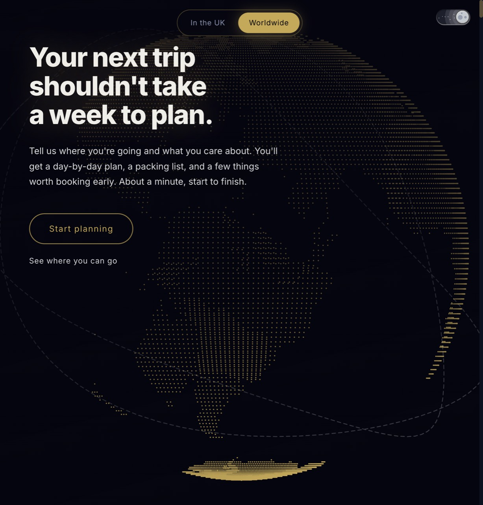

# Voyager AI

<p align="center">
  <strong>AI trip planner</strong> — 10-step intake wizard, one streaming itinerary, structured plan view.<br/>
  No post-generation chat. The plan panel is the product.
</p>

<p align="center">
  <a href="https://9chirla.github.io/voyager-ai/"></a>
  <a href="https://github.com/9chirla/voyager-ai/actions"></a>
  
  
  
  
</p>

<p align="center">
  
</p>

<p align="center">
  <a href="https://9chirla.github.io/voyager-ai/"><strong>Open live demo →</strong></a>
</p>

## How it works

1. **Collection wizard (10 steps, zero API calls)** — destination, dates, flights, stay, group, budget, diet, travel style  
2. **Single generation call** — one streaming DeepSeek request builds the full plan  
3. **Trip Plan view** — days stream in; checklist + tips; download `.txt` anytime  

## Quick start

```bash
git clone https://github.com/9chirla/voyager-ai.git
cd voyager-ai
cp .env.example .env   # set DEEPSEEK_API_KEY
npm install
npm run dev            # Vite :5173 + Express :3001
```

| Variable | Required | Description |
|----------|----------|-------------|
| `DEEPSEEK_API_KEY` | Yes | Server-only; never sent to the browser |
| `ALLOWED_ORIGIN` | Prod | CORS origin for the API |
| `PORT` | No | Production port (default `8080`) |

```bash
npm test
npm run build
```

Static Pages build: `npm run build:pages` (see `.github/workflows/pages.yml`).

## Stack

React 18 · Vite · Express · DeepSeek Chat · Tailwind · Playwright / Vitest · GitHub Pages

## License

[MIT](LICENSE)
